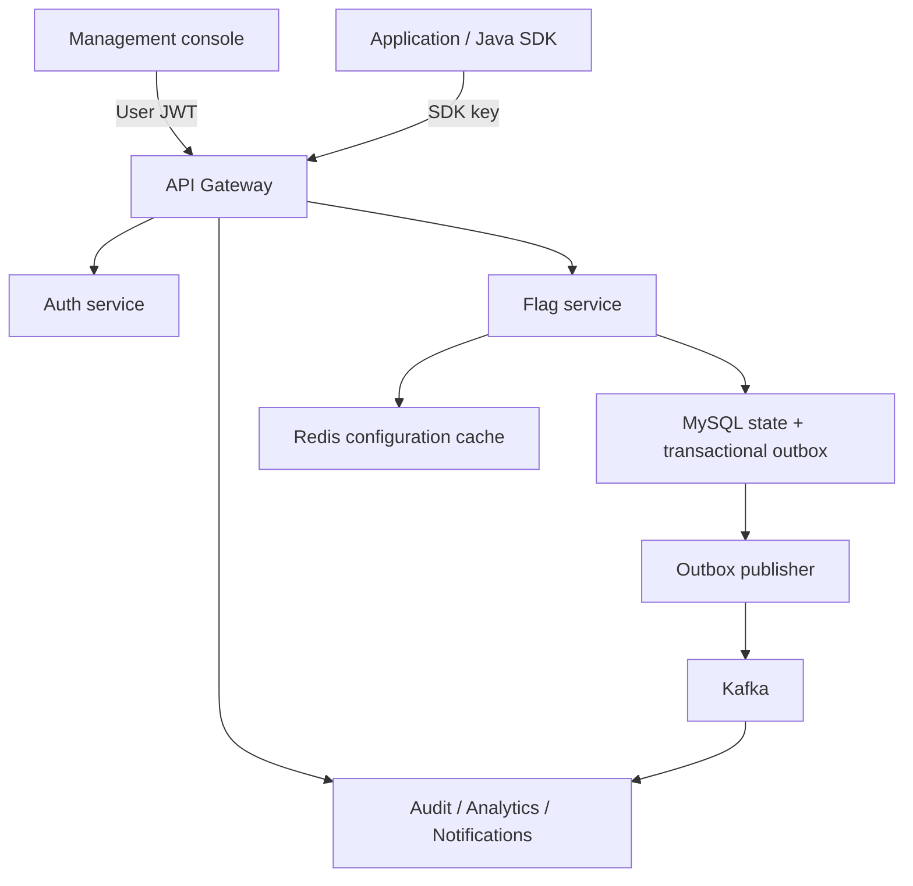

# Feature Flag Platform

[](https://github.com/manishjangid1499-cell/featureflag/actions/workflows/ci.yml)


Release a feature independently of deploying an application. This platform gives teams a management console for environment-specific flags and applications a separate SDK-authenticated evaluation API.

Built with **Java 21, Spring Boot, Kafka, Redis, MySQL, React, and Docker Compose**. The backend focuses on reliable event publication, concurrent updates, authorization boundaries, and recovery from infrastructure failures.

**[Live application](https://featureflags.duckdns.org)** · **[Local setup](docs/GETTING_STARTED.md)** · **[Engineering reference](docs/ENGINEERING.md)** · **[Deployment runbook](docs/DEPLOYMENT.md)** · **[Java SDK](sdk/java-sdk/README.md)**

The hosted console requires an invited account; there is no public self-registration or shared administrator credential. [Screenshots](docs/SCREENSHOTS.md) provide an account-free walkthrough.


## What it does

- Manage flags across `DEV`, `QA`, `STAGING`, and `PROD`, with schedules, subject targeting, and deterministic percentage rollouts.
- Invite members and enforce `OWNER`, `ADMIN`, `DEVELOPER`, and `VIEWER` permissions on the backend, including restrictions on developer mutations in PROD.
- Issue environment-bound SDK keys, reveal each secret once, and revoke it without granting management access.
- Record lifecycle audit history, aggregate analytics, and process email notifications with visible retry state.
- Preview a decision in the console separately from an application's runtime evaluation.

## Engineering decisions

| Problem | Implementation | Boundary / tradeoff |
|---|---|---|
| A database update succeeds but Kafka is unavailable | Flag changes and lifecycle outbox rows commit in one MySQL transaction; a publisher retries after commit | At-least-once publication; terminal failures need operator recovery |
| Kafka redelivers an event | Consumers persist event IDs alongside database effects in a transaction | Database effects are idempotent; external SMTP delivery is not exactly once |
| Two users edit the same flag | Versioned writes require `expectedVersion`; stale writes return `409` | The client refreshes instead of overwriting a newer change |
| Redis becomes unavailable | Cache configuration, bound Redis waits, and fall back to MySQL | Database load increases during an outage; Redis is not the source of truth |
| Runtime telemetry delays evaluation | Send telemetry through a bounded background worker | Evaluation counts may be lost; they are not a billing ledger |
| A role changes while a JWT is still valid | Resource services verify the JWT and consult Auth for current account authorization | Auth availability participates in protected request handling |
| Applications need credentials independent of users | SDK keys select an environment and authorize evaluation only; stored keys are hashed | Applications must rotate keys and choose a safe fallback |

Implementation details, failure semantics, and recovery procedures are in the [engineering reference](docs/ENGINEERING.md).

## Architecture

The control plane uses user JWTs; the runtime plane uses SDK keys. Business services own separate MySQL schemas and database users, hosted in one MySQL instance in the Compose topology.



Eureka provides service discovery. In production, TLS terminates at an edge Nginx proxy before the internal frontend Nginx and gateway. Only ports `80` and `443` are published; backend and infrastructure ports stay on the Docker network.

| Component | Source | Responsibility |
|---|---|---|
| Auth | [auth-service](auth-service/auth-service) | Login, account authorization, members, invitations |
| Flag | [flag-service](flag-service/flag-service) | Management, evaluation, SDK keys, outbox |
| Audit | [audit-service](audit-service/audit-service) | Idempotent lifecycle history |
| Analytics | [analytics-service](analytics-service/analytics-service) | Atomic event aggregation |
| Notification | [notification-service](notification-service/notification-service) | Durable notification claims and SMTP delivery |
| Gateway / discovery | [api-gateway](api-gateway/api-gateway), [eureka-server](eureka-server/eureka-server) | Routing and service discovery |
| Console | [Frontend](Frontend/feature-flag-ui) | React, TypeScript, Vite, Nginx |
| SDK | [java-sdk](sdk/java-sdk) | Java 21 HTTP client with explicit caller fallback |

Java modules are independent Maven projects. The repeated service directory names reflect the existing build layout.

## Runtime integration

Create an SDK key for the desired environment and keep it in the consuming application's server-side environment. Build and install the SDK with:

```bash
mvn -f sdk/java-sdk/pom.xml clean install
```

```java
import com.featureflag.sdk.FeatureFlagClient;
import java.time.Duration;

FeatureFlagClient flags = FeatureFlagClient.builder()
        .baseUrl(System.getenv("FEATURE_FLAG_BASE_URL"))
        .sdkKey(System.getenv("FEATURE_FLAG_SDK_KEY"))
        .connectTimeout(Duration.ofSeconds(1))
        .requestTimeout(Duration.ofSeconds(2))
        .build();

boolean darkModeAvailable =
        flags.isEnabled("ledgerguard_dark_mode", "user-123", false);
```

Reuse the client. Network errors, timeouts, non-200 responses, and invalid response bodies return the caller's default. The SDK does not perform offline evaluation or local flag caching.

Underlying contract:

```http
GET /runtime/v1/flags/{flagKey}/evaluate?subject={subject}
X-Feature-Flag-Key: <environment-bound-sdk-key>
```

**Integration exercised:** LedgerGuard, running on a separate VM, uses the Java SDK to gate dark-mode availability with the PROD flag `ledgerguard_dark_mode`. ON/OFF behavior was checked through the consuming application. This verifies an integration workflow, not throughput or an availability SLA.

## Run locally

Follow the [setup guide](docs/GETTING_STARTED.md) to provision private RSA keys, database credentials, internal service keys, SMTP settings, and the initial owner.

After configuring `.env`:

```bash
docker compose config --quiet
docker compose up --build -d
docker compose ps
```

Open `http://localhost:3000` unless `FRONTEND_PORT` is overridden. Direct frontend development uses `http://localhost:5174`; the setup guide explains the required origin configuration.

For a disposable environment with generated credentials and a local SMTP sink, use the [E2E guide](scripts/e2e/README.md). Never put production secrets or SDK keys into browser configuration or Git.

## Verification

[GitHub Actions](.github/workflows/ci.yml) runs on pull requests and pushes to `main`.

| Layer | Verification |
|---|---|
| Backend and SDK | Maven `clean verify` for seven services and the Java SDK; production JAR checks reject test material |
| MySQL behavior | Testcontainers profiles for Auth, Flag, Audit, Analytics, and Notification; migrations, locking, counters, rollback, and claims |
| Redis / Kafka behavior | Flag `infrastructure-it` profile |
| Frontend | Node's test runner, including React StrictMode lifecycle tests; Oxlint; TypeScript/Vite build and CSP validation |
| System workflows | Disposable E2E scripts for browser flows, invitations, SDK revocation, Redis fallback, and Kafka recovery; run separately from the CI matrix |

Example commands from the repository root:

```bash
mvn -f flag-service/flag-service/pom.xml clean verify
mvn -f flag-service/flag-service/pom.xml verify -Pmysql-it
mvn -f flag-service/flag-service/pom.xml verify -Pinfrastructure-it
```

```bash
cd Frontend/feature-flag-ui
npm ci
npm test
npm run lint
npm run build
```

## Deployment and operating scope

The portfolio deployment runs on **OCI Ampere ARM64, Ubuntu 24.04, Docker Compose**, with Nginx TLS termination and Let's Encrypt webroot renewal. Credentials live outside the checkout. The [production runbook](docs/DEPLOYMENT.md) documents memory budgets, certificate hooks, firewall considerations, and backup/restore procedures.

Operational checks performed include SDK evaluation and revocation, certificate-renewal simulation, container recovery after reboot, and restoration of a downloaded MySQL backup into an isolated local container. Daily logical database backups are scheduled on the deployed host; copying backups off the VM is currently manual.

The deployment is **one VM**, with one MySQL instance and one Kafka broker. It demonstrates end-to-end operation but does not provide high availability, multi-region replication, tenant isolation, or a measured throughput/SLA guarantee. Health checks alone do not prove every business endpoint works. Memory budgets require monitoring under representative use.

Other current limits include process-local login rate limiting, manual DLT replay, best-effort evaluation analytics, no bundled tracing/Prometheus/Grafana deployment, and no publicly published SDK artifact.

## Documentation

- [Local development and configuration](docs/GETTING_STARTED.md)
- [Evaluation, security, event contracts, and recovery](docs/ENGINEERING.md)
- [Production deployment and operations](docs/DEPLOYMENT.md)
- [Screenshots and management workflows](docs/SCREENSHOTS.md)
- [Local event pipeline](docs/local-event-pipeline.md)
- [Disposable end-to-end tests](scripts/e2e/README.md)
- [Java SDK usage and response validation](sdk/java-sdk/README.md)
