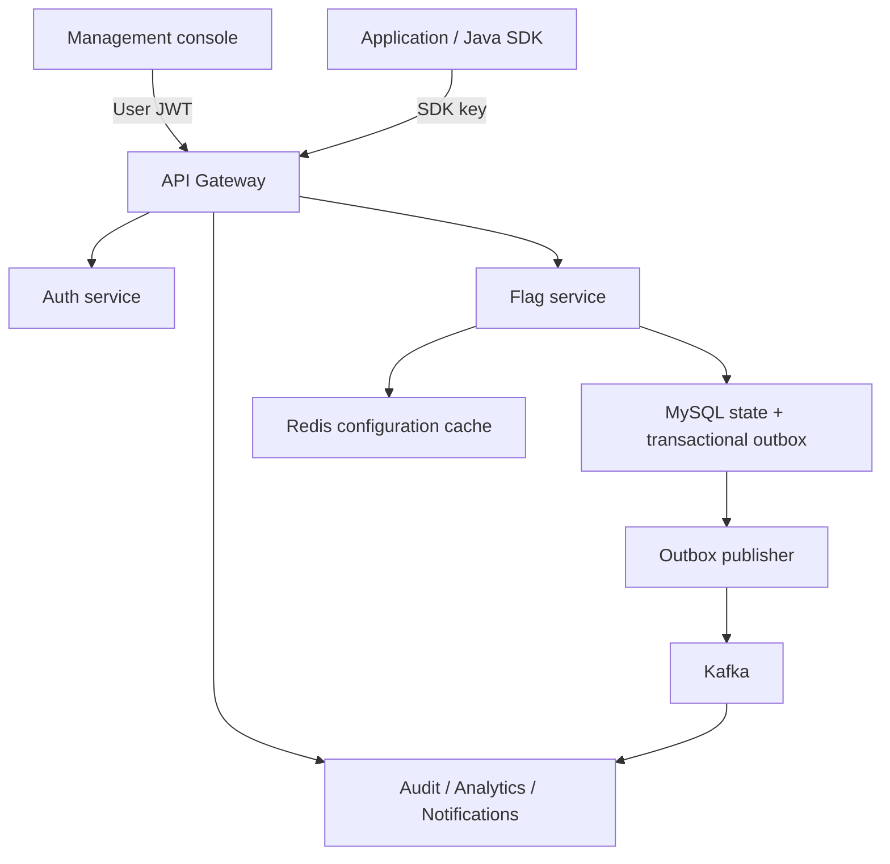
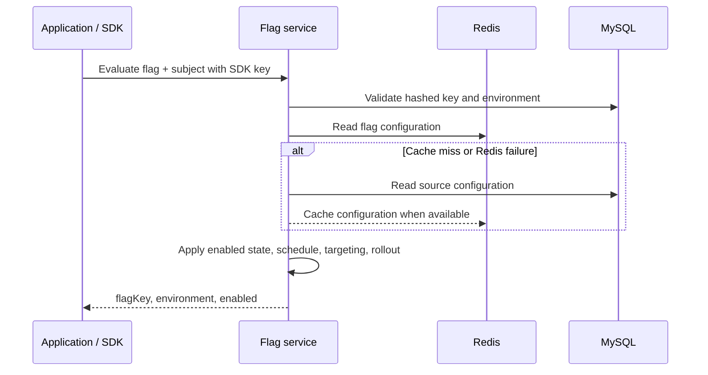
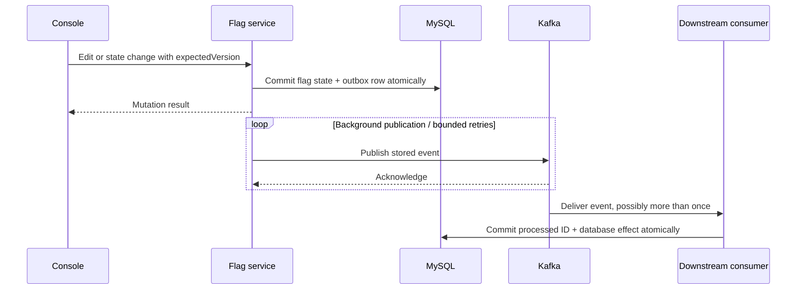
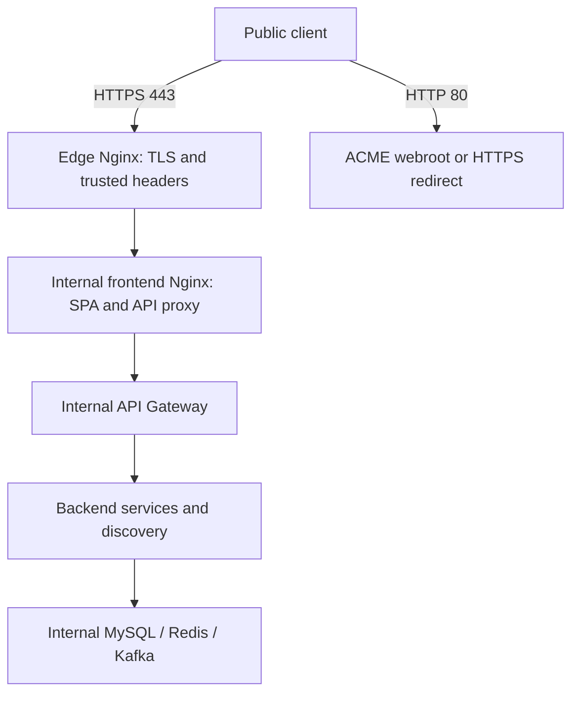
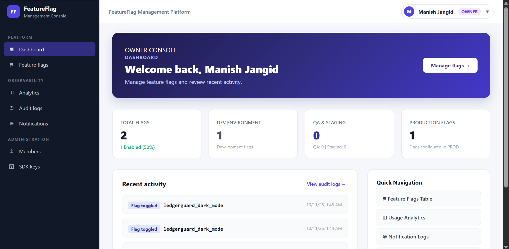
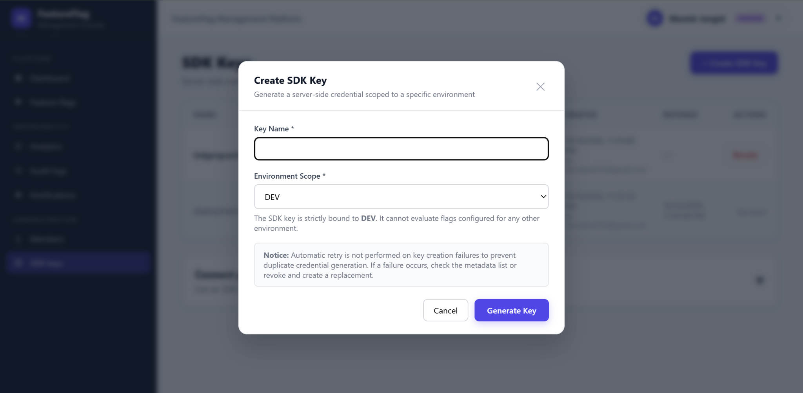

# Feature Flag Platform

[](https://github.com/manishjangid1499-cell/featureflag/actions/workflows/ci.yml)


Release a feature independently of deploying an application. This platform gives teams a management console for environment-specific flags and applications a separate SDK-authenticated evaluation API.

Built with **Java 21, Spring Boot, Kafka, Redis, MySQL, React, and Docker Compose**. The backend focuses on reliable event publication, concurrent updates, authorization boundaries, and recovery from infrastructure failures.

**[Live application](https://featureflags.duckdns.org)** · **[Local setup](docs/GETTING_STARTED.md)** · **[Engineering reference](docs/ENGINEERING.md)** · **[Deployment runbook](docs/DEPLOYMENT.md)** · **[Java SDK](sdk/java-sdk/README.md)**

The hosted console requires an invited account; there is no public self-registration or shared administrator credential. [Screenshots](docs/SCREENSHOTS.md) provide an account-free walkthrough.


## Contents

- [Product workflow](#product-workflow)
- [Technology stack](#technology-stack)
- [Engineering decisions](#engineering-decisions)
- [Architecture](#architecture)
- [Evaluation and event flows](#evaluation-and-event-flows)
- [Security and permissions](#security-and-permissions)
- [Application walkthrough](#application-walkthrough)
- [Runtime integration](#runtime-integration)
- [API conventions](#api-conventions)
- [Run locally](#run-locally)
- [Repository map](#repository-map)
- [Verification](#verification)
- [Deployment and operating scope](#deployment-and-operating-scope)
- [Troubleshooting](#troubleshooting)
- [Documentation](#documentation)

## What it does

- Manage flags across `DEV`, `QA`, `STAGING`, and `PROD`, with schedules, subject targeting, and deterministic percentage rollouts.
- Invite members and enforce `OWNER`, `ADMIN`, `DEVELOPER`, and `VIEWER` permissions on the backend, including restrictions on developer mutations in PROD.
- Issue environment-bound SDK keys, reveal each secret once, and revoke it without granting management access.
- Record lifecycle audit history, aggregate analytics, and process email notifications with visible retry state.
- Preview a decision in the console separately from an application's runtime evaluation.

## Product workflow

A flag represents a release decision for one environment, not a deployment artifact. An application asks whether that flag is enabled for a subject, then chooses its normal or new behavior.

1. Provision the first OWNER in a fresh Auth database, then disable bootstrap and clear its configured password.
2. Invite teammates with the appropriate role. Invitations are time-limited; resending replaces the previous token.
3. Create a flag such as `ledgerguard_dark_mode` in `DEV`; configure enabled state, rollout percentage, optional schedule, and target subjects.
4. Use **Preview** to inspect a decision without adding runtime evaluation telemetry.
5. Create a DEV SDK key and evaluate through the application's backend. For production, create the flag and key in `PROD`.
6. Change the flag without redeploying the consuming application. Inspect lifecycle history, aggregate analytics, and notification state.
7. Rotate credentials by creating a replacement SDK key, updating the application, and revoking the previous key.

Environment-bound keys prevent a DEV client from selecting PROD through a query parameter. Turning off a flag or placing it outside its schedule overrides targeting and rollout.

## Technology stack

| Area | Technology | Use |
|---|---|---|
| Backend | Java 21, Spring Boot, Spring Data JPA | Business APIs, transactions, persistence |
| Routing | Spring Cloud Gateway, Eureka | Routing and service discovery |
| Authorization | Spring Security, RS256 JWT, BCrypt | Human authentication and backend role enforcement |
| Database | MySQL 8.4, Flyway | Service-owned schemas, migrations, durable work |
| Messaging | Apache Kafka | Lifecycle events, notifications, evaluation telemetry |
| Cache | Redis, Lettuce | Reusable flag configuration with database fallback |
| Console | React 19, TypeScript, Vite | Management UI and protected navigation |
| SDK | JDK HttpClient, Jackson | Server-side evaluation with caller-selected fallback |
| Deployment | Docker Compose, Nginx, Certbot | Container topology, TLS, renewal |
| Quality | JUnit, Mockito, Testcontainers, Node tests, Oxlint, GitHub Actions | Unit, infrastructure, UI, build checks |
| Operations | Actuator, Micrometer | Health and Prometheus-compatible metrics |

Exact dependency versions are defined in each module's `pom.xml` and the frontend `package.json` / lockfile.

## Engineering decisions

| Problem | Implementation | Boundary / tradeoff |
|---|---|---|
| A database update succeeds but Kafka is unavailable | Flag changes and lifecycle outbox rows commit in one MySQL transaction; a publisher retries after commit | At-least-once publication; terminal failures need operator recovery |
| Kafka redelivers an event | Consumers persist event IDs alongside database effects in a transaction | Database effects are idempotent; external SMTP delivery is not exactly once |
| Two users edit the same flag | Versioned writes require `expectedVersion`; stale writes return `409` | The client refreshes instead of overwriting a newer change |
| Redis becomes unavailable | Cache configuration, bound Redis waits, and fall back to MySQL | Database load increases during an outage; Redis is not the source of truth |
| Runtime telemetry delays evaluation | Send telemetry through a bounded background worker | Evaluation counts may be lost; they are not a billing ledger |
| A role changes while a JWT is still valid | Resource services verify the JWT and consult Auth for current account authorization | Auth availability participates in protected request handling |
| Applications need credentials independent of users | SDK keys select an environment and authorize evaluation only; stored keys are hashed | Applications must rotate keys and choose a safe fallback |

Implementation details, failure semantics, and recovery procedures are in the [engineering reference](docs/ENGINEERING.md).

## Architecture

The control plane uses user JWTs; the runtime plane uses SDK keys. Business services own separate MySQL schemas and database users, hosted in one MySQL instance in the Compose topology.



Eureka provides service discovery. In production, TLS terminates at an edge Nginx proxy before the internal frontend Nginx and gateway. Only ports `80` and `443` are published; backend and infrastructure ports stay on the Docker network.

| Component | Source | Responsibility |
|---|---|---|
| Auth | [auth-service](auth-service/auth-service) | Login, account authorization, members, invitations |
| Flag | [flag-service](flag-service/flag-service) | Management, evaluation, SDK keys, outbox |
| Audit | [audit-service](audit-service/audit-service) | Idempotent lifecycle history |
| Analytics | [analytics-service](analytics-service/analytics-service) | Atomic event aggregation |
| Notification | [notification-service](notification-service/notification-service) | Durable notification claims and SMTP delivery |
| Gateway / discovery | [api-gateway](api-gateway/api-gateway), [eureka-server](eureka-server/eureka-server) | Routing and service discovery |
| Console | [Frontend](Frontend/feature-flag-ui) | React, TypeScript, Vite, Nginx |
| SDK | [java-sdk](sdk/java-sdk) | Java 21 HTTP client with explicit caller fallback |

Java modules are independent Maven projects. The repeated service directory names reflect the existing build layout.

## Evaluation and event flows

### Runtime decision



The diagram omits ingress hops. Schedule checks use UTC instants. Rollout uses a SHA-256-derived bucket from environment, flag key, and subject; repeated evaluation is stable for the same inputs. Redis caches configuration rather than the final subject-specific decision, with a five-minute TTL and post-commit invalidation.

Runtime telemetry is submitted to a bounded background worker independently of the response. Queue saturation or Kafka failure can lose evaluation events; console Preview does not submit these events.

### Durable lifecycle publication



An acknowledged event can still be delivered again, so consumers deduplicate by persisted event identity. Exhausted publication stays visible as terminal work; consumer failures use retry/backoff and dead-letter topics. SMTP is an external side effect and is not covered by a database exactly-once guarantee.

### Production trust boundary



The edge overwrites forwarded scheme, port, and client-IP headers, and clears the client-supplied `Forwarded` header. The production frontend preserves the edge's metadata. Development uses a separate Nginx configuration. Access logs omit query strings to reduce token exposure.

## Security and permissions

| Identity | Allowed purpose | Important restriction |
|---|---|---|
| OWNER | Administrative management, invitations, ownership transfer | A separate ownership-transfer operation maintains one owner |
| ADMIN | Administrative flag/SDK operations and management of developers/viewers | Cannot assign OWNER/ADMIN or modify peer administrative accounts |
| DEVELOPER | Feature-management work outside PROD | PROD mutations are forbidden |
| VIEWER | Read access where permitted | No flag mutations or SDK-key administration |
| SDK key | Runtime evaluation in its assigned environment | No control-plane access |
| Internal service key | Explicit service-to-service endpoints | Separate from user and SDK credentials |

The backend is authoritative; hiding a button is not authorization. Resource services verify RS256 signatures, issuer, audience, and token timing, then resolve current account authorization through Auth. A demoted or disabled account cannot rely solely on a stale JWT role.

Passwords use BCrypt with a 72 UTF-8-byte maximum. Invitation and SDK secrets are hashed at rest; raw SDK keys are revealed once and passed in a header, never a URL. Invitation/reset tokens are handled as sensitive data. Production credentials and RSA private keys stay outside Git. Login throttling is bounded and process-local, not a distributed perimeter control.

See the [security and credential details](docs/ENGINEERING.md#security-model).

## Application walkthrough

Dashboard, flags, creation dialogs, invitation, and login screenshots were refreshed from the application on 11 October 2026. They show sample deployment state, not benchmark results. See the [screenshot gallery](docs/SCREENSHOTS.md) for captures and refresh status.

| Screen | What to inspect |
|---|---|
| Dashboard | Account identity, role, summary metrics, activity |
| Feature flags | Environment, state, rules, versions, Preview |
| Members | Role restrictions, invitation status, safe resend |
| SDK keys | Environment-bound metadata, one-time reveal, revocation |
| Audit | Lifecycle history and before/after state |
| Analytics | Aggregate lifecycle/evaluation events, not unique users |
| Notifications | PENDING / FAILED / SENT; SENT means provider acceptance |

<details>
<summary>Dashboard, flag configuration, invitations, and SDK credentials</summary>






</details>

## Runtime integration

Create an SDK key for the desired environment and keep it in the consuming application's server-side environment. Build and install the SDK with:

```bash
mvn -f sdk/java-sdk/pom.xml clean install
```

```java
import com.featureflag.sdk.FeatureFlagClient;
import java.time.Duration;

FeatureFlagClient flags = FeatureFlagClient.builder()
        .baseUrl(System.getenv("FEATURE_FLAG_BASE_URL"))
        .sdkKey(System.getenv("FEATURE_FLAG_SDK_KEY"))
        .connectTimeout(Duration.ofSeconds(1))
        .requestTimeout(Duration.ofSeconds(2))
        .build();

boolean darkModeAvailable =
        flags.isEnabled("ledgerguard_dark_mode", "user-123", false);
```

Reuse the client. Network errors, timeouts, non-200 responses, and invalid response bodies return the caller's default. The SDK does not perform offline evaluation or local flag caching.

Underlying contract:

```http
GET /runtime/v1/flags/{flagKey}/evaluate?subject={subject}
X-Feature-Flag-Key: <environment-bound-sdk-key>
```

**Integration exercised:** LedgerGuard, running on a separate VM, uses the Java SDK to gate dark-mode availability with the PROD flag `ledgerguard_dark_mode`. ON/OFF behavior was checked through the consuming application. This verifies an integration workflow, not throughput or an availability SLA.

## API conventions

| Operation | Method and route | Credential |
|---|---|---|
| Login / current profile | `POST /auth/login`, `GET /auth/profile` | Login input / JWT |
| Password change | `POST /auth/change-password` | JWT |
| List / invite members | `GET /members`, `POST /members/invite` | JWT with appropriate role |
| Create / list flags | `POST /flags`, `GET /flags` | JWT with appropriate role |
| Update a flag | `PUT /flags/{id}` | JWT; expectedVersion required |
| Delete a flag | `DELETE /flags/{id}` | JWT with appropriate role |
| Set desired enabled state | `PATCH /flags/{id}/toggle` | JWT; explicit desired state and expectedVersion |
| Console preview | `GET /flags/{flagKey}/evaluate` | JWT |
| Create / list SDK keys | `POST /sdk-keys`, `GET /sdk-keys` | OWNER / ADMIN JWT |
| Revoke SDK key | `POST /sdk-keys/{id}/revoke` | OWNER / ADMIN JWT |
| Application evaluation | `GET /runtime/v1/flags/{flagKey}/evaluate?subject=...` | SDK key header |

This is a route overview, not a substitute for request DTOs and controller validation. Flag key and environment are immutable after creation. SDK runtime environment comes from the key.

Paginated responses use zero-based `page` with bounded `size` and return `content`, `page`, `size`, `totalElements`, and `totalPages`. Application errors use `application/problem+json`; `400` signals validation, `401` authentication, `403` authorization, `404` a missing resource, `409` a conflict, and `429` login throttling. Correlation IDs support diagnosis without rendering raw exceptions in the UI.

## Run locally

Follow the [setup guide](docs/GETTING_STARTED.md) to provision private RSA keys, database credentials, internal service keys, SMTP settings, and the initial owner.

After configuring `.env`:

```bash
docker compose config --quiet
docker compose up --build -d
docker compose ps
```

Open `http://localhost:3000` unless `FRONTEND_PORT` is overridden. Direct frontend development uses `http://localhost:5174`; the setup guide explains the required origin configuration.

For a disposable environment with generated credentials and a local SMTP sink, use the [E2E guide](scripts/e2e/README.md). Never put production secrets or SDK keys into browser configuration or Git.

## Repository map

| Path | Contents |
|---|---|
| `*-service/<same-service>/`, `api-gateway/api-gateway/`, `eureka-server/eureka-server/` | Independent Maven modules with code, migrations, tests, Dockerfiles |
| `Frontend/feature-flag-ui/` | Console source, lifecycle regressions, build/CSP checks |
| `sdk/java-sdk/` | Reusable Java runtime client and its tests |
| `docker/mysql/init/` | Initial schema and database-user provisioning |
| `docker/nginx/` | Production edge and internal frontend configurations |
| `docker-compose.yml` | Local full-stack deployment |
| `docker-compose.prod.yml` | Production topology and memory budgets |
| `docker-compose.kafka-local.yml` | Kafka support for direct JVM development |
| `.env.example`, `.env.production.example` | Configuration templates without real secrets |
| `scripts/e2e/` | Disposable system and invitation workflow checks |
| `.github/workflows/ci.yml` | Backend, native integration, frontend, SDK CI |
| `docs/` | Setup, engineering, deployment, screenshots, event pipeline |

## Verification

[GitHub Actions](.github/workflows/ci.yml) runs on pull requests and pushes to `main`.

| Layer | Verification |
|---|---|
| Backend and SDK | Maven `clean verify` for seven services and the Java SDK; production JAR checks reject test material |
| MySQL behavior | Testcontainers profiles for Auth, Flag, Audit, Analytics, and Notification; migrations, locking, counters, rollback, and claims |
| Redis / Kafka behavior | Flag `infrastructure-it` profile |
| Frontend | Node's test runner, including React StrictMode lifecycle tests; Oxlint; TypeScript/Vite build and CSP validation |
| System workflows | Disposable E2E scripts for browser flows, invitations, SDK revocation, Redis fallback, and Kafka recovery; run separately from the CI matrix |

Example commands from the repository root:

```bash
mvn -f flag-service/flag-service/pom.xml clean verify
mvn -f flag-service/flag-service/pom.xml verify -Pmysql-it
mvn -f flag-service/flag-service/pom.xml verify -Pinfrastructure-it
```

```bash
cd Frontend/feature-flag-ui
npm ci
npm test
npm run lint
npm run build
```

## Deployment and operating scope

The portfolio deployment runs on **OCI Ampere ARM64, Ubuntu 24.04, Docker Compose**, with Nginx TLS termination and Let's Encrypt webroot renewal. Credentials live outside the checkout. The [production runbook](docs/DEPLOYMENT.md) documents memory budgets, certificate hooks, firewall considerations, and backup/restore procedures.

Operational checks performed include SDK evaluation and revocation, certificate-renewal simulation, container recovery after reboot, and restoration of a downloaded MySQL backup into an isolated local container. Daily logical database backups are scheduled on the deployed host; copying backups off the VM is currently manual.

The deployment is **one VM**, with one MySQL instance and one Kafka broker. It demonstrates end-to-end operation but does not provide high availability, multi-region replication, tenant isolation, or a measured throughput/SLA guarantee. Health checks alone do not prove every business endpoint works. Memory budgets require monitoring under representative use.

Other current limits include process-local login rate limiting, manual DLT replay, best-effort evaluation analytics, no bundled tracing/Prometheus/Grafana deployment, and no publicly published SDK artifact.

## Troubleshooting

| Symptom | Check / recovery |
|---|---|
| Browser fails on direct Vite development | Port 5174 must match `FRONTEND_BASE_URL` and backend CORS overrides; some defaults still use 5173 |
| Container is healthy but a page fails | Inspect the relevant service's recent logs and the request correlation ID; readiness is not a full workflow test |
| `OutOfMemoryError: Metaspace` | Inspect JVM Metaspace and container limits together; monitor actual usage and recreate only the affected service after a validated configuration change |
| Flag mutation returns `409` | Refresh the record and review the newer version; do not blindly retry with stale state |
| Lifecycle event is delayed | Inspect outbox state, Kafka availability, and downstream consumer failures; preserve event IDs during recovery |
| Notification says SENT but email is absent | SENT is SMTP provider acceptance; check recipient/spam/provider behavior separately |
| SDK returns fallback | Check environment, flag key, key revocation, connectivity, timeouts, and response validity |
| ACME challenge returns `404` | Verify webroot bind mount and traversal/read permissions for the Nginx worker before renewal |

Use the [deployment runbook](docs/DEPLOYMENT.md) for exact production commands and the [engineering reference](docs/ENGINEERING.md#operational-recovery) for terminal outbox/DLT recovery. Avoid deleting persistent volumes as a troubleshooting shortcut.

## Documentation

- [Local development and configuration](docs/GETTING_STARTED.md)
- [Evaluation, security, event contracts, and recovery](docs/ENGINEERING.md)
- [Production deployment and operations](docs/DEPLOYMENT.md)
- [Screenshots and management workflows](docs/SCREENSHOTS.md)
- [Local event pipeline](docs/local-event-pipeline.md)
- [Disposable end-to-end tests](scripts/e2e/README.md)
- [Java SDK usage and response validation](sdk/java-sdk/README.md)
