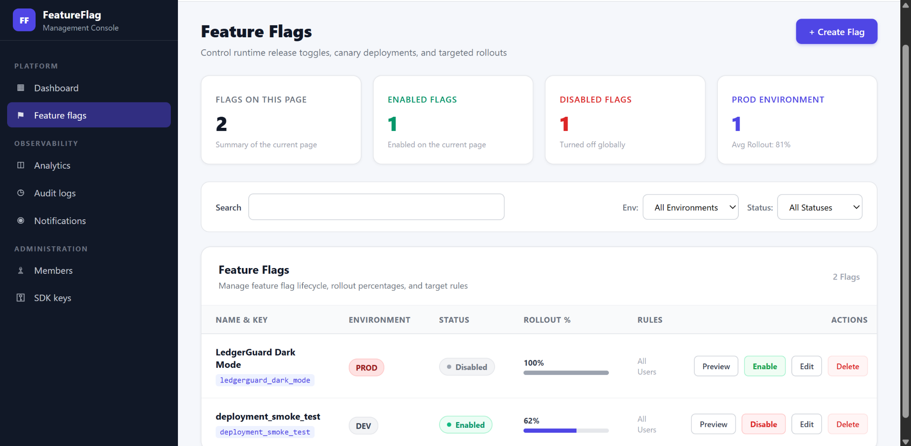
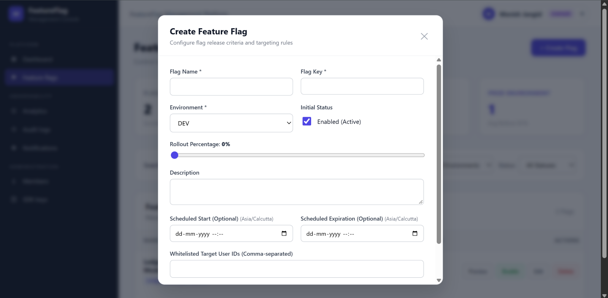
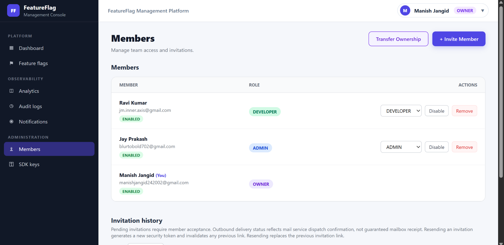
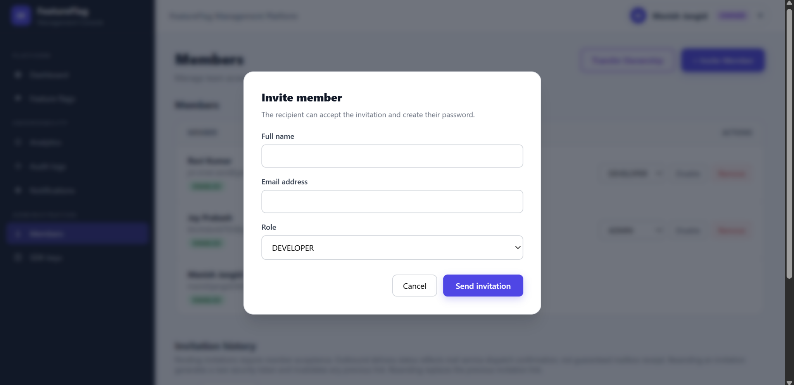
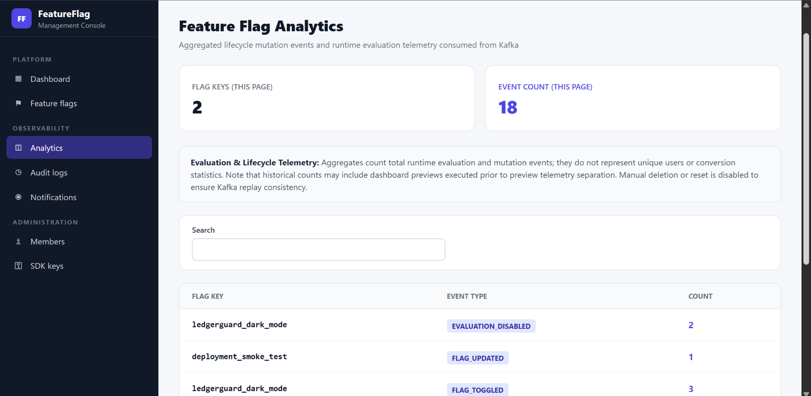
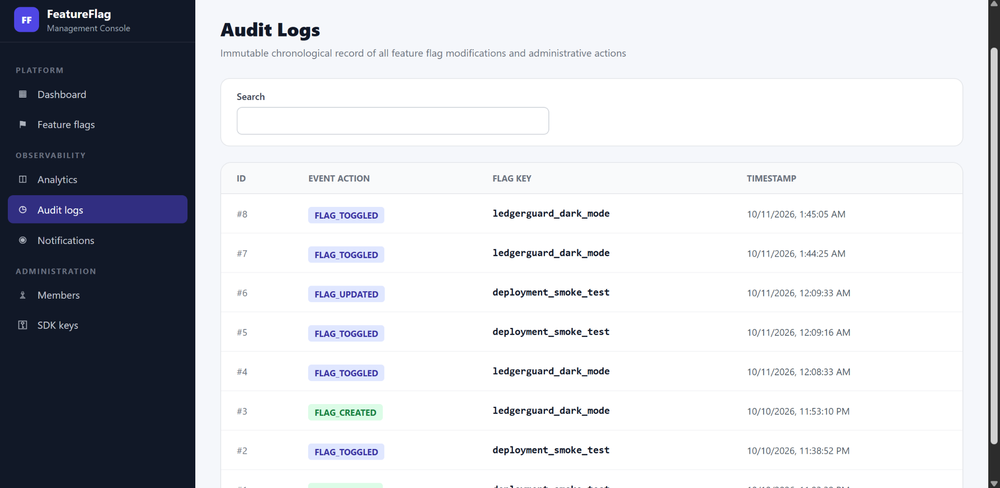
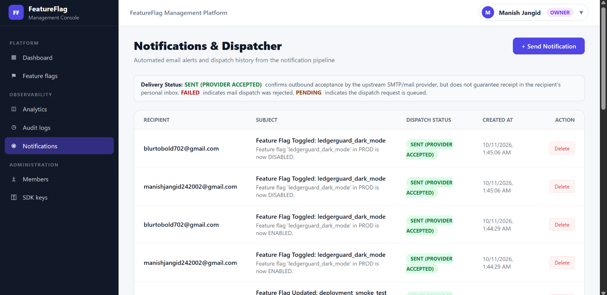

# Application Screenshots

[Project overview](../README.md)

Screenshots illustrate the management workflows; the running deployment may contain newer UI changes.

### Feature Flag Management

  

The control plane supports environment-specific flag lifecycle management, filtering, rollout percentages, targeting rules, and preview actions (without recording runtime evaluation telemetry).

### Create and Configure a Flag

  

Flag creation supports environment selection, initial state, rollout percentage, optional schedules, descriptions, and targeted subject IDs.

### Member and Role Administration

  

The platform uses `OWNER`, `ADMIN`, `DEVELOPER`, and `VIEWER` roles with backend-enforced authorization boundaries.

### Invitation Workflow

  

Invitations allow administrators to onboard members without creating passwords on their behalf. Invitees choose their password after accepting the invitation.

### Analytics

  

Analytics aggregates lifecycle mutations and runtime evaluation telemetry consumed from Kafka.

### Audit Logs

  

Audit records provide a chronological history of feature-flag lifecycle activity.

### Notifications

  

Notification history exposes provider acceptance and retry state; SENT does not prove inbox delivery for invitation and lifecycle email processing.
