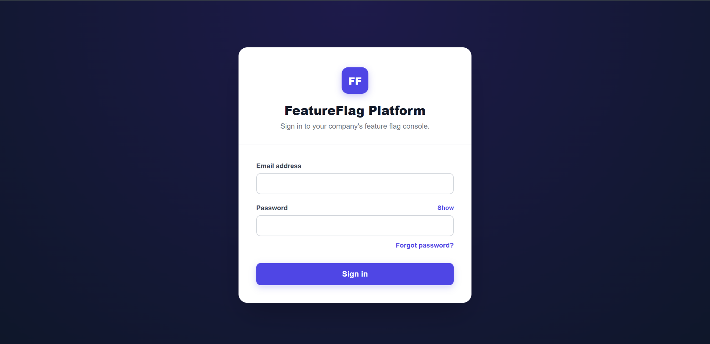
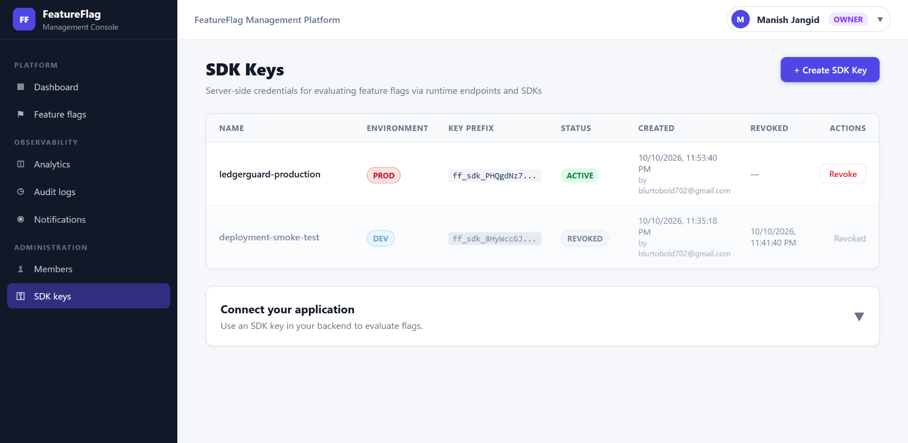

# Application Screenshots

[Project overview](../README.md) · [Engineering reference](ENGINEERING.md)

The following captures were supplied from the application on **11 October 2026**. They show the current UI and sample deployment state. Counts, rollout settings, and flag status are examples, not performance measurements. Screenshots are stored without altering application data or inventing screen content.

## Dashboard

Account identity and role, environment summaries, recent lifecycle activity, and navigation.

## Feature flag management

Environment and state filtering, rollout percentages, and Preview / mutation actions. The displayed disabled PROD flag illustrates a configuration state; it does not indicate integration failure.

## Create a flag

Environment, initial state, rollout, description, schedules with timezone context, and target subject IDs. This viewport shows the form fields; its submit controls are below the visible area.

## Member administration

The supplied names and email addresses are fictitious test data, as confirmed by the project author. The listing illustrates OWNER, ADMIN, and DEVELOPER roles, account state, administrative actions, and invitation semantics.

## Invite a member

Administrators invite a recipient with a role; the recipient chooses their own password through the invitation flow.

## Create an SDK credential

The dialog binds a server-side credential to one environment and explains recovery from creation failures. This capture is taken before generation and contains no raw SDK key.

## Sign in

The management console requires an existing account; no public self-registration or shared administrative credentials are provided.

## SDK-key administration

Environment-bound metadata lists active and revoked credentials, creation details, and revocation controls. Only display prefixes are shown; the raw credential is revealed once at creation and is absent from this capture.

## Analytics

Lifecycle mutations and runtime evaluation telemetry are aggregated by event type. These are event counts, not unique users or conversion statistics. Historical aggregates can include previews made before telemetry separation; current Preview does not emit runtime telemetry.

## Audit history

The current implementation records feature-flag lifecycle events such as creation, updates, and state changes. Despite the broader subtitle visible in this capture, it is not a complete organization-wide administrative or security audit log, nor a tamper-proof external ledger.

## Notifications

Dispatch history explains PENDING, FAILED, and SENT. SENT indicates SMTP provider acceptance and does not guarantee inbox receipt. Displayed recipient addresses are test data, as confirmed by the project author.

## Capture notes

All eleven views in this gallery were refreshed with author-supplied captures on 11 October 2026. Some views are viewport captures and require scrolling in the application to see additional rows or controls. The supplied test account addresses are retained with the author's authorization. No raw SDK credentials, passwords, or invitation tokens are shown.
